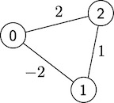

# CMPS 6610 Problem Set 05
## Answers


**Name:**$\underline{\hspace{1in}\text{Rob Hartley}\hspace{1in}}$


## 1. Shortest shortest paths


**1b) (4 pts)** Work and span  

Initializing the best dictionary requires: $O(|V|)$  
Initializing pq: $O(1)$  
Process vertices and edges in the nested While..For loop: $O(|V| + |E|)$  
Heap operations heappush() and heappop(): $O(\log|V|)$  
Return the dictionary: $O(1)$  

Because each edge processed in the While..For loop can potentially call a heappush() operation and each record pushed can potentially call a heappop() operation, there is a potential of $O(|V| + |E|)$ heap operations, each of which costs $O(\log|V|)$ under simple graph assumption: 

$W(|V|,|E|) = O((|V| + |E|)\log|V|) + O(|V|) + O(1) + O(|V| + |E|) + O(1)$

$\boxed{W(|V|,|E|) = O((|V| + |E|)\log|V|)}$  

Because there is no parallelism, span will equal work:  

$\boxed{S(|V|,|E|) = O((|V| + |E|)\log|V|)}$


## 2. Expression Trees


**2a) (3 pts)** Expression tree algorithm with work and span  

*Note: The input for this algorithm must be tokenized with whitespace between tokens. Negative numbers and decimals not supported.   
Valid Input: ( 3 + 4 ) * 5  
Invalid Input: (3+4)*5

```python  
class Node:
    def __init__(self, value, left=None, right=None):
        self.value = value
        self.left = left
        self.right = right


def build_expression_tree(expression):
    operands = []
    operators = []

    precedence = {
        '+': 1,
        '-': 1,
        '*': 2,
        '/': 2
    }

    def apply_operator():
        operator = operators.pop()

        right = operands.pop()
        left = operands.pop()

        new_node = Node(operator, left, right)
        operands.append(new_node)

    for token in expression.split():

        # Step 1: Encounter a number
        if token.isdigit():
            operands.append(Node(int(token)))

        # Step 1.5: Encounter a variable
        elif token.isidentifier():
            operands.append(Node(token))

        # Step 2: Encounter an opening parenthesis
        elif token == '(':
            operators.append(token)

        # Step 3: Encounter a closing parenthesis
        elif token == ')':
            while operators and operators[-1] != '(':
                apply_operator()

            operators.pop()  # Remove '('

        # Step 4: Encounter an operator
        elif token in precedence:

            while (operators and
                   operators[-1] != '(' and
                   precedence[operators[-1]] >= precedence[token]):
                apply_operator()

            operators.append(token)

    # Step 5: Apply remaining operators
    while operators:
        apply_operator()

    # Step 6: Return the root
    return operands.pop()
```
The work for most of the operations involved in $O(1)$. Although the algorithm does contain nested while loops, each operator is pushed and popped from its respective stack exactly once. The algorithm assumes non-negative integers; it can't process decimals or negative numbers.
expression.split() = $\Theta(n)$  
iterate through all the tokens =  $\Theta(n)$  
Apply remaining operators = $O(n)$  

$\boxed{W(n) = \Theta(n)}$  

The algorithm contains no parallelism, so span is the same as work.  

$\boxed{S(n) = \Theta(n)}$ 


**2b) (2 pts)** Corresponding arithmetic expression work and span?  

Tree $T_E$ can be evaluated recursively. Each leaf provides a value, and each internal node applies the operator it contains to the values returned by its two children. Every node is processed in $O(1)$ constant time, so we end up with the same work as before.  

$\boxed{W(n) = \Theta(n)}$   

The span is different, however. Because we're evaluating the left and right trees in parallel, but each parent node must wait for its children to process, the span will be based on the maximum depth of the tree, $d$.  

$\boxed{S(n) = \Theta(d)}$  

If the tree is balanced, this works out to:  

$\boxed{S(n) = \Theta(\log n)}$  

Worst case unbalanced tree can move the span up to:  

$\boxed{S(n) = \Theta(n)}$  


**2c) (2 pts)** work/span to update a previously computed value  

The answer is similar to 2b, in that the span will be proportional to tree depth, but in this case because we're only updating one value the work is also proportional to tree depth (*assuming intermediate results are stored in the nodes and only one leaf is changing) we're only processing the change to variable and any required alterations along the affected path through the tree from the node change we're making to the root. For depth $d$, work and span are:  

$\boxed{W(n) = O(d)}$  

$\boxed{S(n) = O(d)}$

For a balanced tree, this works out to:  

$\boxed{W(n) = \Theta(\log n)}$  

$\boxed{S(n) = \Theta(\log n)}$  

Unbalanced tree in the worst case where we have an update path containing $\Theta(n)$ nodes:  

$\boxed{W(n) = \Theta(n)}$  

$\boxed{S(n) = \Theta(n)}$

## 3. Improving Dijkstra


**3a) (2 pts)** Maximum depth of a $d$-ary heap  

The maximum depth of a d-ary heap is $\Theta(\log_d n)$, where $d$ = the maximum number of children per node and $n$ = the number of nodes. The heap's shape property ensures that all levels except the bottom are completely filled, with the bottom level being filled from the left to the right. The height of the tree grows logarithmically with $n$, using base $d$.


**3b) (3 pts)** Work done by `delete-min` and `insert` operations in a $d$-ary heap.

Delete-min requires at most $O(d \cdot log_d n)$ work. The new root will travel downward through the heap by at most $log_d n$ levels, and it must examine up to $d$ children at each level in order to find the smallest child node to swap positions with.  

Insert requires at most $O(log_d n)$ work because it only has to compare the inserted value with one parent node per level to check for a potential position swap with that parent node as it moves up the tree.

**3c) (3 pts)** New bound on the work for Dijkstra's using $d$-ary heap 

Dijkstra's algorithm performs at most $O(|V|)$ delete-min operations. Because each delete-min operation costs at most $O(d \cdot log_d n)$ work and Dijkstra's algorithm will do at most $O(|V|)$ of them, total work for delete-min operations is $O(d|V|\log_d |V|)$.  

The algorithm will also process up to $O(|E|)$ priority queue insertions or updates. Each of those operations is going to require at most $O(log_d n)$ work, which gives us a maximum total work of $O(|E|\log_d |V|)$ for the insertions and updates.  

Therefore, the maximum total work for Dijkstra's algorithm is:  

$\boxed{O((d|V| + |E|)(\log_d |V|))}$.


**3d) (3 pts)** What value of $d$ yields an overall running time of $O(|E|)$?  

 We start with the work equation from 3c, $W \in O((d|V| + |E|)(\log_d |V|))$.  
 Set $d|V| = |E|$, so that the delete-min work has the same asymptotic bound as the insertion and update work.  
 $d = \frac{|E|}{|V|}$  
 substitute target edge value: $d = \frac{|V|^{1 + \epsilon}}{|V|}$  
 $d = |V|^{\epsilon}$  
 substitute into main equation: $W = O((|V|^{\epsilon}|V| + |E|)(\log_{|V|^{\epsilon}} |V|))$  
 $W = O((|V|^{1 + \epsilon} + |E|)(\frac{1}{\epsilon}))$  
$W = O((2|E|)(\frac{1}{\epsilon}))$  
Constants absorbed by Big-O notation $|E|$.  

$\boxed{W \in O(|E|)}$


## 4. All-pairs shortest paths using Dynamic Programming

**4a) (2 pts)** Consider the following graph with 3 vertices.



Compute $\mathit{APSP}(i, j, k)$ for all $i, j, k$.  

There are three vertices, 0, 1, and 2. With $i$ representing the starting vertex by row, $j$ representing the destination vertex by column, and $k$ representing the maximum index vertex permitted as an intermediate vertex, each entry at $(i,j)$ represents the weight calculated for a walk from $i$ to $j$. Matrix $D^{-1}$ represents the direct edge weights when no intermediate vertices are permitted. The three matrices underneath it show the results of the Floyd–Warshall recurrence for $0 \leq k \leq 2$ as we allow intermediate vertices $k = 0$ (vertex 0), $k = 1$ (vertices 0, 1) and $k = 2$ (vertices 0, 1, 2). The graph contains a negative cycle, $0 \rightarrow 1 \rightarrow 0$, with total weight $-4$. Therefore, the finite values produced by the recurrence do not represent well defined unrestricted shortest walk distances, since repeating the negative cycle can decrease walk weights without bound.

$$
D^{-1} =
\begin{bmatrix}
0 & -2 & 2 \\
-2 & 0 & 1 \\
2 & 1 & 0
\end{bmatrix}
$$  

$$
APSP(i,j,0) =
\begin{bmatrix}
0 & -2 & 2 \\
-2 & -4 & 0 \\
2 & 0 & 0
\end{bmatrix}
$$  

$$
APSP(i,j,1) =
\begin{bmatrix}
-4 & -6 & -2 \\
-6 & -8 & -4 \\
-2 & -4 & 0
\end{bmatrix}
$$  

$$
APSP(i,j,2) =
\begin{bmatrix}
-4 & -6 & -2 \\
-6 & -8 & -4 \\
-2 & -4 & 0
\end{bmatrix}
$$  

**4b) (3 pts)** Relationship between $\mathit{APSP}(i, j, 1)$ and
$\mathit{APSP}(i, j, 2)$. Can you write $\mathit{APSP}(i, j, 2)$ in
terms of $\mathit{APSP}(i, j, 0)$ and $\mathit{APSP}(i, j, 1)$ only?

The Floyd-Warshall recurrence for $\mathit{APSP}(i, j, 2)$ is:  


$APSP(i,j,2) =
\min
\begin{cases}
\mathit{APSP}(i,j,1), \\
\mathit{APSP}(i,2,1) + \mathit{APSP}(2,j,1)
\end{cases}$


The overall relationship between the 3 values is:  

$\mathit{APSP}(i,j,2) \leq \mathit{APSP}(i,j,1) \leq \mathit{APSP}(i,j,0)$   

Each increase in $k$ allows an additional vertex to be used as an intermediate vertex, while preserving all previously permitted intermediate vertices. The minimum total walk weight can only decrease or remain unchanged as additional intermediate vertices are permitted. By the time we're ready to compute $\mathit{APSP}(i,j,2)$, the best intermediate walk weight using only vertices 0 and 1 as permitted vertices is going to be $\mathit{APSP}(i,j,1)$. In order to compute $\mathit{APSP}(i,j,2)$, we need to compare $\mathit{APSP}(i,j,1)$ with new possible paths that include vertex 2, which will require us to look at $\mathit{APSP}(i,2,1)$ and $\mathit{APSP}(2,j,1)$. Therefore, generally speaking, we can't express $\mathit{APSP}(i,j,2)$ strictly in terms of $\mathit{APSP}(i,j,0)$ and $\mathit{APSP}(i,j,1)$ for the same pair of vertices $(i, j)$.  

In the case of this specific graph, however, we can express $\mathit{APSP}(i,j,2)$ strictly in terms of $\mathit{APSP}(i,j,1)$ because the two matrices are identical.

**4c) (3 pts)** Generalize your observation from b) above to give an optimal substructure property for $\mathit{APSP}(i, j, k).$  

The optimal substructure property for $\mathit{APSP}(i,j,k)$ is:  

$\mathit{APSP}(i,j,k) =
\min
\begin{cases}
\mathit{APSP}(i,j,k-1), \\
\mathit{APSP}(i,k,k-1) + \mathit{APSP}(k,j,k-1)
\end{cases}$

We compare the shortest path that doesn't pass through vertex $k$ as an intermediate vertex with the shortest path that does pass through vertex $k$ as an intermediate vertex and take the one with the minimum weight of the two.

**4d) (3 pts)** How many distinct subproblems will be computed from scratch, and
what is the resulting work of this dynamic programming algorithm?  

There are $n$ possible starting vertices $i$.  
There are $n$ possible destination vertices $j$  
There are $n$ possible values for $k$ ranging from $0$ to $n -1$   

This gives us $n \cdot n \cdot n = n^3$ subproblems. Due to memoization table storage, each subproblem is computed once. Each subproblem requires a constant number of table lookups, one addition operation, and one comparison operation, all of which are constant time operations. Total work is therefore:  

$W(n) = n^3 \cdot \Theta(1)$  

$\boxed{W(n) = \Theta(n^3)}$


**4e) (3 pts)** Compare the work of this algorithm against that of just running
Dijkstra $n$ times. Is our dynamic programming algorithm better than this?  

Our dynamic programming algorithm from 4d has a total work of:  

$W_{P}(n) = \Theta(n^3)$

For a single execution of finding the shortest path from one vertex to all the others, the standard Dijkstra's algorithm using a binary heap priority queue requires this amount of work, with $n$ representing vertices and $m$ representing edges:  

$W_{D}(n,m) = O((n + m)\log n)$  

To find shortest path between all vertices, as our dynamic programming algorithm does, Dijkstra's algorithm must run $n$ times, so the total work we get for Dijkstra is:  

$W_{D}(n,m) = O(n(n + m)\log n)$  

Whether the dynamic programming algorithm does better than Dijkstra's algorithm for this purpose depends on the number of edges in the graph being analyzed.  

A graph is considered sparse if the number of edges in a graph grows proportionately with the number of vertices. A graph is considered dense if the number of edges grows quadratically with the number of vertices. This difference in edges makes no difference for the asymptotic work involved in our dynamic programming algorithm, but it does cause a change in the asymptotic work for Dijkstra's algorithm:  

Sparse: $m = \Theta(n)$  

$W_{D}(n) = O(n(n + n)\log n)$  
$W_{D}(n) = O(n^2\log n)$  

$W_{P}(n) = \Theta(n^3)$

Dense: $m = \Theta(n^2)$  

$W_{D}(n) = O(n(n + n^2)\log n)$  
$W_{D}(n) = O(n^3\log n)$  

$W_{P}(n) = \Theta(n^3)$  

Therefore we would expect Dijkstra's algorithm in the worst case to be more efficient than the dynamic programming algorithm for sparse graphs, but less work efficient than the dynamic programming algorithm for dense graphs. Additionally, Floyd-Warshall can handle negative edge weights provided no negative cycles exist, whereas Dijkstra's algorithm requires nonnegative edge weights.

## 5. Spanning trees

**5a) (3 pts)** Is a solution to MST guaranteed to be a solution to MMET? Why or why not?  

Yes, MST is guaranteed to find a solution for MMET. An MST minimizes the total weight of all edges in the spanning tree, whereas the MMET minimizes the weight of the largest edge in the spanning tree.  

Consider a solution to MST that produces a spanning tree that contains an edge with a larger weight than the maximum weight of an edge in some alternative spanning tree for the same graph. If we were to remove this edge from the MST, this would create two disconnected span components. Because our alternative tree is a spanning tree, it must contain at least one edge connecting those two components. Because the alternative tree's maximum edge weight is smaller than the weight of the edge that was removed from the original MST, this means that every edge in the alternative tree is smaller than the one that was removed, including the edge that would connect the two disconnected MST components. Connecting these two components with the new edge would produce a new spanning tree with a lower total edge weight than the original MST, which would contradict the optimality of the original MST. Therefore every MST is also an MMET in the same graph.$\blacksquare$

**5b) (2 pts)** Suppose that the optimal solution to MST is impossible to use for some reason. Describe an algorithm to instead find the next best tree (pseudo-code or English is fine). That is, return the tree with the next lowest weight.  

1. Use Kruskal's algorithm to find an MST that contains no cycles for the graph being processed.

2. Process an edge that was not included in the MST by adding that edge back to the MST. This will form one cycle.  

3. For each edge in the newly formed cycle aside from the one that was added, temporarily remove it and record the total weight of the new spanning tree that is formed. Keep the minimum total edge weight spanning tree found this way, and overwrite it with a new spanning tree whenever one with a lower total edge weight is found. The original MST is retained in separate variable for use in the rest of the comparisons. Comparisions take the form of:  
Original MST Weight - Removed Edge Weight + Added Edge Weight = Current Spanning Tree Weight.

4. Repeat steps 2 and 3 for each edge not included in the original MST until every edge has been processed.  

5. Return the lowest weight spanning tree recorded during this process as the next lowest weight spanning tree.  

**5c) (2 pts)** What is the work of your algorithm?  

Using Kruskal's algorithm to find the MST: $O(|E|\log|E|)$  

Find the cycle and remove edges to compare span weights: $O(|V|)$ per iteration  

Process each edge not included in the MST:  $O(|E|)$ iterations  

All the rest of the work is constant. The total work is:  

$\boxed{W(|E|, |V|) \in O(|E|\log|E| + |E||V|)}$


